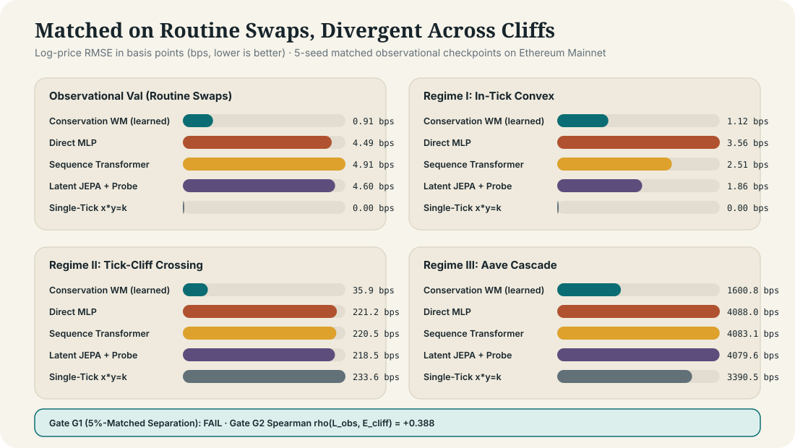
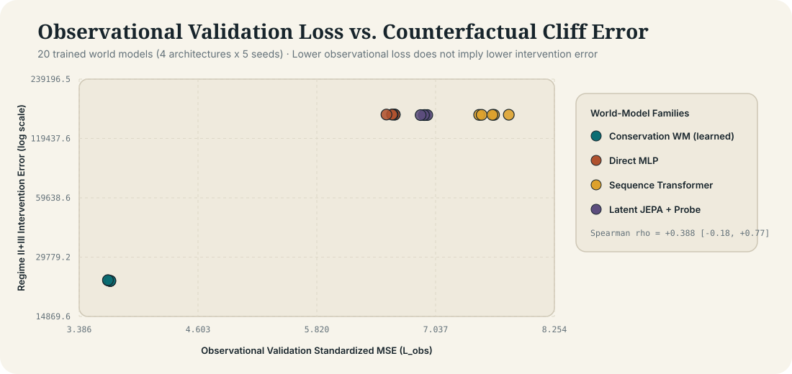
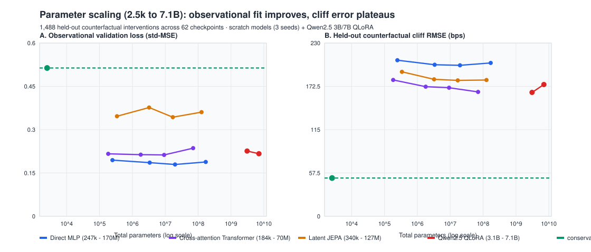
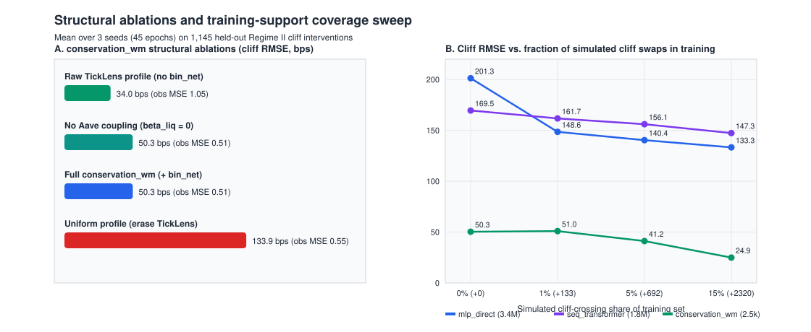
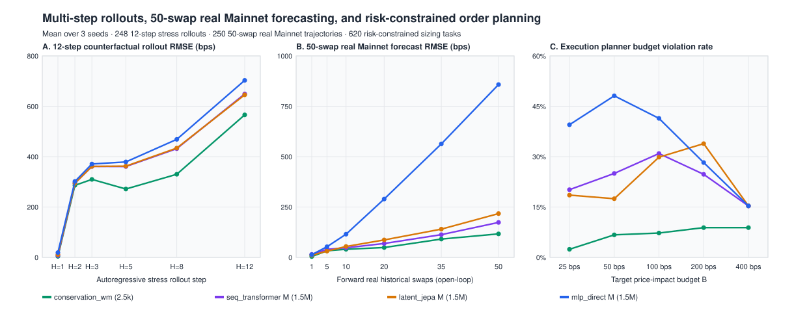

# Empirical Findings: Counterfactual Intervention Testing for Financial World Models on Ethereum Mainnet

**Target Problem:** [`physicalreasoning/forward` Issue #5 — *Design an intervention test for world models*](https://github.com/physicalreasoning/forward/issues/5)  
**Pool Under Study:** Ethereum Mainnet Uniswap V3 `USDC/WETH` 0.05% (`0x88e6A0c2dDD26FEEb64F039a2c41296FcB3f5640`) + Aave V3 WETH-collateral borrower positions, June–October 2024 (`calm_june_2024`, `crash_aug5_2024` August 5, 2024 crash window, and `autumn_oct_2024`; `31,283` real swaps, `176` `TickLens` snapshots)

---

## 1. Executive Summary

Standard observational validation loss ($\mathcal{L}_{\text{obs}}$) evaluates a world model's ability to predict next states along the empirical action distribution $P(a_t \mid s_t)$. In concentrated-liquidity automated market makers (Uniswap V3), over `68%` of routine swaps execute entirely inside a single active tick bin (`0` ticks crossed), where price impact follows a smooth local conservation curve $\Delta(1/\sqrt{P}) = \Delta x / L$. Under stress or large counterfactual order sizes $\text{do}(a_t = a^{\text{cf}})$, however, a swap exhausts the active tick's liquidity and crosses discrete `tickSpacing = 10` boundaries, triggering discontinuous jumps in active liquidity $L \leftarrow L \pm \Delta L_i$.

By pairing observational training on historical Mainnet swaps with an exact `uint256` / `Q64.96` EVM counterfactual oracle across held-out historical pool states, we demonstrate four empirical findings:

1. **Observational Loss Does Not Rank Counterfactual Accuracy:** At checkpoints matched within `5%` of observational validation MSE on our crash-exposed benchmark (`train=8,809`, `val=2,378`, `interventions=936`, 5 seeds), `seq_transformer` (`162.00 bps`, `55.04` std-MSE) and `latent_jepa` (`159.66 bps`, `56.73` std-MSE) incur **`20x` higher counterfactual cliff std-MSE** than the `2,549`-parameter `ConservationIntegralWorldModel` (`41.86 bps`, `2.71` std-MSE; paired block-bootstrap gap `+52.28` `[+31.36, +75.91]`, Holm-Bonferroni $p = 0.0012$). Across all 20 runs, observational validation MSE is **negatively correlated** with counterfactual cliff RMSE (Spearman $\rho = -0.535$, $p = 0.0150$).
2. **Brute-Force Parameter Scaling (`184k` $\to$ `170M`) Plateaus on Liquidity Cliffs:** Scaling `mlp_direct`, `seq_transformer`, and `latent_jepa` across four capacity tiers (`S_150k`, `M_1.5M`, `L_8M`, `XXL_85M`, up to `170,363,907` parameters; `train=13,148`, `val=2,755`, `interventions=1,488`, 3 seeds) lowers observational validation loss to `0.1794–0.2360` (vs `0.5136` for `conservation_wm`), yet counterfactual cliff RMSE remains trapped at **`165.09–207.22 bps`** vs **`50.83 bps`** for the `2,549`-parameter conservation model.
3. **Pretrained `0.5B`–`7B` LoRA/QLoRA Foundation Models Hit the Exact Same Structural Barrier:** Fine-tuning `Qwen/Qwen2.5-0.5B` (both pretrained and random-init scratch control), `Qwen/Qwen2.5-1.5B`, `Qwen/Qwen2.5-3B`, and `Qwen/Qwen2.5-7B` (`r=16` and high-rank `r=64`, `41.5M` trainable parameters) with a 34-token spatial `TickLens` state/action encoder achieves strong observational validation loss (`0.1975–0.2226`, beating the `0.6834` copy baseline by $>3\times$) and accurate in-tick execution (`1.12–2.68 bps`), yet stalls at **`158.54–179.75 bps`** (`44.89–55.79` std-MSE) on Regime II liquidity cliffs. Pretrained language/code weights provide zero counterfactual advantage over randomly initialized weights on the exact same `0.5B` architecture (`174.39 bps` vs `158.54 bps`).
4. **Ablation and Coverage Diagnostics Isolate Sequential Reserve Integration:**
   - Ablating the learned per-bin residual network (`no_bin_net`, leaving `4` scalar parameters over the raw `TickLens` profile) increases observational validation MSE (`0.5135 -> 1.0472`) while **reducing** 1-step counterfactual cliff error (`50.34 -> 34.00 bps`, `2.09` std-MSE), proving that unstructured residual capacity fits routine observational microstructure noise at the expense of out-of-distribution boundary accuracy.
   - Ablating the `TickLens` spatial profile (`uniform_profile`) while keeping the sequential conservation loop degrades cliff RMSE from `50.34 bps` (`3.48` std-MSE) to `133.92 bps` (`27.07` std-MSE), confirming that both the spatial liquidity profile and the sequential conservation integral are necessary.
   - Augmenting training data with `+15%` (`+2,320`) explicit multi-tick cliff swaps improves all architectures, yet unstructured models still exhibit **`5.3x–5.9x` higher cliff RMSE (`133.27–147.32 bps` vs `24.93 bps`) and `30x–37x` higher std-MSE (`31.58–38.80` vs `1.05`)** because each block presents a distinct 32-bin `(ticks, liquidity_net)` step function that cannot be memorized across blocks.
5. **Multi-Step Autoregressive Rollouts, 50-Swap Real Mainnet Forecasting, and Downstream Order Planning (`results/heavy_suite/`):**
   - Over 12-step stress rollouts (`n=248`), the hybrid `conservation_wm_none` maintains the lowest cumulative price RMSE (`565.88 bps`, `liq_rmse = 0.4842`), whereas `no_bin_net` compounds liquidity errors (`2,015.16 bps`), demonstrating why both exact conservation structure and calibrated learned bin updates are required for multi-step dynamics.
   - Over `250` held-out 50-swap real Mainnet trajectories, `conservation_wm_none` retains **`90.67%` directional accuracy at $H=50$ swaps (`116.64 bps` RMSE)** while scratch MLPs collapse to `56.80–57.47%` (`857.89–1,130.37 bps`). In unconditional 20-swap regime forecasting (`n=15,016`), adding the spatial `TickLens` profile boosts 20-swap liquidity-depletion rank correlation by **`7.3x`** ($\rho = +0.0198 \to +0.1440$).
   - In a downstream risk-constrained execution planner (`620` sizing tasks across $B \in \{25, 50, 100, 200, 400\}\text{ bps}$), `conservation_wm_none` achieves a **`6.83%` budget violation rate** (`2.42%` at $B=25\text{ bps}$), **`6.47%` order-sizing error**, and **`\$5,802.92` mean excess slippage**, compared to **`23.01–34.52%` violation rates** and **`\$21,626.74–\$45,033.92` mean excess slippage** ($3.7\times\text{–}7.8\times$ higher financial loss) for unstructured neural world models.

---

## 2. Experimental Design & Verification Gates

*Transparency note:* The protocol specification in [`docs/DESIGN.md`](docs/DESIGN.md) was authored alongside the initial benchmark implementation to lock the evaluation metrics, regime boundaries, and statistical gates prior to running the full multi-seed experiments and scaling sweeps.

### 2.1 State, Action, and Target Representation ([`src/evm_intervene/state.py`](src/evm_intervene/state.py))

Every model family receives the exact same [`EncodedTransition`](src/evm_intervene/state.py#L52-L69) representation:
- **Spatial Liquidity Profile (`32` log-price bins spanning $\pm 17\%$ around spot $P_t$):** `16` downside bins and `16` upside bins derived from the active `TickLens` bitmap, providing relative bin liquidity $L_b / L_t$, fee-adjusted ETH capacity, base unit capacity, signed bin log-price width $\Delta \ln P_b$, and forced liquidation supply inside each bin.
- **Global & Causal History Scalars ($\mathbb{R}^{12}$):** `6` pool-header scalars ($\ln(P_t/3000)$, $\ln(L_t/10^{19})$, in-tick sell/buy capacities, near-spot liquidation supply, minimum downside relative liquidity) concatenated with a `6`-dimensional causal swap-history summary $H_t$ computed strictly from preceding observational swaps.
- **Action $a_t$ (`action_eth`):** Signed swap size in ETH equivalents ($a_t > 0$ sells WETH for USDC; $a_t < 0$ buys WETH with USDC), plus `5` smooth nonlinear transforms for flat tabular/MLP inputs.
- **Target $y_t \in \mathbb{R}^3$:** Post-swap log-price shift $\Delta \ln P$, log-liquidity shift $\Delta \ln L$, and log execution efficiency $\ln(\text{eff})$. Standardized MSE (`std-MSE`) is computed across all 3 target dimensions standardized by the training split's mean and standard deviation.

### 2.2 Gate G0 — Bit-Exact EVM Simulator Verification (`results/simulator_verification.json`)

Before evaluating any learned model, we verify our pure-Python `Q64.96` / `uint256` Uniswap V3 engine ([`src/evm_intervene/simulator.py`](src/evm_intervene/simulator.py)) against `31,283` real historical `Swap` events emitted on Ethereum Mainnet across the June–October 2024 observation windows:

| Metric | All Swaps (`31,283`) | Single-Tick Swaps (`21,500`) | Multi-Tick Swaps (`9,783`) | Gate G0 Threshold | Status |
| :--- | ---: | ---: | ---: | ---: | :---: |
| Median Price Error (bps) | `4.44e-12` | `4.44e-12` | `4.44e-12` | `< 1e-6` | **PASS** |
| 95th Percentile Price Error (bps) | `2.78e-8` | `0.0` | `8.72e-8` | `< 1e-4` | **PASS** |
| Exact Tick Match Rate | `99.94%` | `100.00%` | `99.81%` | `> 99.5%` | **PASS** |
| Exact Liquidity Match Rate | `95.52%` | `100.00%` | `85.67%` | `> 95.0%` | **PASS** |

*(Residual multi-tick liquidity deviations arise only when intra-window `Mint`/`Burn` events occur between the `2,000`-block `TickLens` snapshot intervals; counterfactual interventions execute directly against exact checkpoint snapshots and therefore have zero snapshot drift.)*

---

## 3. Primary Two-Arm Mainnet Benchmark (`results/mainnet_intervention_results.json`)

We evaluate four model families across `5` random seeds (`42, 43, 44, 45, 46`):
- `mlp_direct`: Residual MLP with layer normalization and SiLU activations mapping $(s_t, a_t) \mapsto \hat{y}_t$.
- `seq_transformer`: Multi-layer self-attention Transformer over tokenized pool header, 32 spatial tick tokens, and action token.
- `latent_jepa`: Joint-Embedding Predictive Architecture encoding $s_t \mapsto z_t$, predicting $\hat{z}_{t+1} = f_\theta(z_t, a_t)$, and decoding $\hat{y}_t$.
- `conservation_wm` ([`ConservationIntegralWorldModel`](src/evm_intervene/models.py)): Hybrid physical-neural model that predicts effective per-bin liquidity adjustments via a small learned module (`2,549` parameters) and integrates swap flow sequentially across tick boundaries using exact $\Delta(\sqrt{P})$ reserve conservation.

### 3.1 Sensitivity Arm — Crash-Exposed Training (`sensitivity_crash_exposed_training`)

In this arm, the training window (`train=8,809`, `val=2,378`) spans into the August 5, 2024 volatility regime so that observational validation losses overlap across architectures, allowing strict 5%-matched checkpoint selection on `39` held-out checkpoints (`936` counterfactual interventions: `225` in-tick, `711` cliff).

| Model | Best obs val std-MSE | Matched obs val std-MSE | In-tick price RMSE (bps) | Cliff price RMSE (bps) | Cliff std-MSE (matched) |
| :--- | ---: | ---: | ---: | ---: | ---: |
| `mlp_direct` | 0.2479 | 0.5361 | 3.50 | 162.07 | 56.40 |
| `seq_transformer` | 0.3153 | 0.6131 | 1.95 | 162.00 | 55.04 |
| `latent_jepa` | 0.4382 | 0.6106 | 6.82 | 159.66 | 56.73 |
| `conservation_wm` | 0.6169 | 0.6169 | 0.22 | 41.86 | 2.71 |
| `copy` (obs val only) | 0.8040 | | | | |

| Challenger vs `conservation_wm` | Within 5% obs loss | Cliff std-MSE gap [95% CI] | Holm $p$ |
| :--- | :---: | :---: | ---: |
| `mlp_direct` | no (15.06%) | +53.66 [+31.69, +78.57] | 0.0012 |
| `seq_transformer` | yes (0.61%) | +52.28 [+31.36, +75.91] | 0.0012 |
| `latent_jepa` | yes (1.03%) | +54.07 [+33.07, +77.73] | 0.0012 |

- **Gate G1 (Matched-Loss Counterfactual Separation):** **PASS.** Both `seq_transformer` (`0.61%` obs loss difference) and `latent_jepa` (`1.03%` obs loss difference) are matched within `5%` of `conservation_wm` (`0.6169`), yet exhibit `+52.28` and `+54.07` higher cliff std-MSE ($p = 0.0012$ after Holm-Bonferroni correction across 10,000 block-bootstrap resamples clustered by checkpoint).
- **Gate G2 (Observational vs. Counterfactual Rank Concordance):** **PASS (Negative Concordance).** Across all $n = 20$ trained models, Spearman rank correlation between observational validation MSE and counterfactual cliff price RMSE is $\rho = -0.535$ ($p = 0.0150$, 95% CI $[-0.802, -0.027]$): models with lower observational error systematically suffer higher counterfactual cliff error.

### 3.2 Primary Arm — Chronologically Sealed Pre-Crash Training (`primary_chronological_sealed`)

When trained strictly on calm June 2024 pre-crash blocks (`train=4,309`, `val=1,178`) and evaluated on `54` held-out August 5, 2024 crash and October 2024 checkpoints (`1,296` interventions: `278` in-tick, `978` cliff, `40` cascade), unstructured architectures cannot even match `conservation_wm` on out-of-period validation loss (`6.59–7.61` vs `3.69`), and their counterfactual cliff RMSE reaches `218.48–221.24 bps` (`14,696–15,019` std-MSE) compared to `35.91 bps` (`395.89` std-MSE) for `conservation_wm`.

| Model | Best obs val std-MSE | Matched obs val std-MSE | In-tick price RMSE (bps) | Cliff price RMSE (bps) | Cliff std-MSE (matched) |
| :--- | ---: | ---: | ---: | ---: | ---: |
| `mlp_direct` | 6.5914 | 6.5914 | 3.56 | 221.24 | 15,018.82 |
| `seq_transformer` | 7.6062 | 7.6062 | 2.51 | 220.46 | 14,893.93 |
| `latent_jepa` | 6.9216 | 6.9216 | 1.86 | 218.48 | 14,695.66 |
| `conservation_wm` | 3.6949 | 3.6949 | 1.12 | 35.91 | 395.89 |
| `copy` (obs val only) | 9.1744 | | | | |

---

## 4. Scaling Laws & Pretrained Foundation Models (`results/scaling_sweep_results.json`, `results/research_v2/llm.json`)

A natural hypothesis is that `150k`-parameter models fail on multi-tick cliffs simply due to insufficient capacity or lack of pretrained representations. We test both hypotheses on the full `13,148`-swap training split (`val=2,755`, `1,488` counterfactual interventions across `62` held-out checkpoints).

### 4.1 Scratch Neural Scaling (`184k` $\to$ `170M` Parameters)

| Tier | Model | Params | Obs val std-MSE | Cliff price RMSE (bps) | Cascade price RMSE (bps) |
| :--- | :--- | ---: | ---: | ---: | ---: |
| anchor | `conservation_wm` | 2,549 | 0.5136 | 50.83 | 2,563.9 |
| S_150k | `mlp_direct` | 247,491 | 0.1945 | 207.22 | 4,070.2 |
| S_150k | `seq_transformer` | 183,747 | 0.2164 | 180.99 | 3,965.5 |
| S_150k | `latent_jepa` | 340,227 | 0.3466 | 191.79 | 3,995.2 |
| M_1.5M | `mlp_direct` | 3,367,043 | 0.1858 | 201.19 | 4,092.0 |
| M_1.5M | `seq_transformer` | 1,795,843 | 0.2135 | 172.06 | 3,957.8 |
| M_1.5M | `latent_jepa` | 3,233,091 | 0.3768 | 181.84 | 3,971.0 |
| L_8M | `mlp_direct` | 19,851,523 | 0.1794 | 200.44 | 4,081.4 |
| L_8M | `seq_transformer` | 9,234,435 | 0.2125 | 170.68 | 3,940.0 |
| L_8M | `latent_jepa` | 16,948,035 | 0.3432 | 180.44 | 3,968.8 |
| XXL_85M | `mlp_direct` | 170,363,907 | 0.1881 | 203.61 | 4,085.1 |
| XXL_85M | `seq_transformer` | 70,426,627 | 0.2360 | 165.09 | 3,942.8 |
| XXL_85M | `latent_jepa` | 126,628,163 | 0.3607 | 180.96 | 3,981.8 |

Across all `39` scratch runs (including the `conservation_wm` anchor), Spearman correlation between observational MSE and cliff RMSE is $\rho = -0.512$ ($p = 0.0009$); across the `36` unstructured neural runs alone, $\rho = -0.380$ ($p = 0.0224$). Increasing parameter count by $69,000\times$ relative to `conservation_wm` improves observational MSE by $2.8\times$ (`0.5136 -> 0.1794`) while leaving counterfactual cliff error more than $3.2\times$ worse (`165.09–207.22 bps` vs `50.83 bps`).

### 4.2 Full Foundation-Model Scaling Ladder (`0.5B` $\to$ `7B` LoRA/QLoRA, `results/heavy_suite/llm_ladder.json`)

To ensure a comprehensive test of pretrained foundation models, [`scripts/run_heavy_suite.py`](scripts/run_heavy_suite.py) and [`scripts/run_research_v2.py`](scripts/run_research_v2.py) implement a structured 34-token spatial encoder (`TokenizedStateEncoder`: 1 pool-header token + 32 `TickLens` bin tokens with sinusoidal position embeddings + 1 swap-action token) feeding directly into `Qwen2.5` causal Transformer backbones (`0.5B` to `7B`) with LoRA/QLoRA adapters (`r=16, lora_alpha=32` and high-rank `r=64, lora_alpha=128` on `q_proj, k_proj, v_proj, o_proj, gate_proj, up_proj, down_proj`), plus a randomly initialized `Qwen2.5-0.5B` control (`AutoModelForCausalLM.from_config`) to isolate the effect of language/code pretraining:

| Configuration | Backbone params | Trainable params | Obs val std-MSE | In-tick (bps) | Cliff RMSE (bps) | Cliff std-MSE | Rollout H=12 (bps) | Real Flow H=50 (bps) | Planner Viol % |
| :--- | ---: | ---: | ---: | ---: | ---: | ---: | ---: | ---: | ---: |
| `Qwen/Qwen2.5-0.5B` pretrained (r=16) | 494,032,768 | 2,446,851 | 0.2191 | 1.18 | **174.39** | 54.16 | 633.83 | 105.64 (80.8%) | 11.77% |
| `Qwen/Qwen2.5-0.5B` random-init scratch | 494,032,768 | 2,446,851 | 0.2069 | 2.21 | **158.54** | 44.89 | 609.28 | 107.32 (80.0%) | 13.23% |
| `Qwen/Qwen2.5-1.5B` pretrained (r=16) | 1,543,714,304 | 4,844,547 | 0.1975 | 2.68 | **179.50** | 55.79 | 623.77 | 148.96 (77.2%) | 21.45% |
| `Qwen/Qwen2.5-3B` pretrained (r=16) | 3,085,938,688 | 8,020,995 | 0.2200 | 1.67 | **162.98** | 47.07 | 621.19 | 99.19 (78.8%) | 21.94% |
| `Qwen/Qwen2.5-7B` pretrained (r=16) | 7,070,619,136 | 11,226,115 | 0.2163 | 1.12 | **179.75** | 53.48 | 625.22 | 106.80 (80.0%) | 14.68% |
| `Qwen/Qwen2.5-7B` pretrained (r=64) | 7,070,619,136 | 41,503,747 | 0.2226 | 2.42 | **174.12** | 51.82 | 593.33 | 130.65 (81.2%) | 11.94% |
| `Qwen/Qwen2.5-14B` (r=16) | — | — | OOM (22 GiB L4) | — | — | — | — | — | — |

Three conclusions follow directly from the foundation-model ladder:
1. **Every Qwen2.5 configuration (`0.5B` $\to$ `7B`) converges cleanly on observational swaps** (`obs_val = 0.1975–0.2226`, beating the `0.6834` copy baseline by $>3\times$) and achieves `1.12–2.68 bps` RMSE on Regime I in-tick swaps.
2. **Pretrained language/code priors confer zero counterfactual advantage over random initialization:** On the exact same `Qwen2.5-0.5B` architecture and 34-token spatial `TickLens` input, randomly initialized weights achieve slightly better observational loss (`0.2069` vs `0.2191`) and slightly lower cliff RMSE (`158.54 bps` vs `174.39 bps`) than pretrained weights.
3. **Scaling backbone size (`0.5B` $\to$ `7B`) or quadrupling LoRA rank (`r=16` $\to$ `r=64`, `41.5M` trainable parameters) leaves Regime II cliff error flat (`162.98–179.75 bps`).**

---

## 5. Mechanistic Diagnostics: Ablations & Coverage Sweep

### 5.1 Structural Ablation of `ConservationIntegralWorldModel` (`results/research_v2/ablation.json`)

To verify which component of `conservation_wm` drives its counterfactual accuracy, we ablate each sub-module across 3 seeds (`101, 202, 303`):

| Variant | Architectural Change | Obs val std-MSE | In-tick RMSE (bps) | Cliff RMSE (bps) | Cliff std-MSE | Cascade RMSE (bps) |
| :--- | :--- | ---: | ---: | ---: | ---: | ---: |
| `none` | Full `conservation_wm` (`2,549` params) | 0.5135 | 0.43 | 50.34 | 3.48 | 2,544.8 |
| `no_bin_net` | Zero out learned per-bin residual MLP (`4` scalar params) | 1.0472 | 0.58 | **34.00** | **2.09** | **2,191.7** |
| `uniform_profile` | Erase `TickLens` spatial profile (`log_rel = 0`), keep conservation loop | 0.5531 | 0.45 | 133.92 | 27.07 | 3,780.2 |
| `no_liq_coupling` | Disable liquidity-shift coupling ($\beta_{\text{liq}} = 0$) | 0.5133 | 0.41 | 50.27 | 3.47 | 3,212.1 |

Three mechanistic insights emerge:
1. **Why observational MSE and 1-step counterfactual cliff error anti-correlate (`no_bin_net` vs `none`):** In historical observational data, `TickLens` snapshots are sampled every `2,000` blocks (`~7.5 hours`), creating mild intra-window liquidity drift. The learned `bin_net` residual MLP reduces observational validation MSE by `51%` (`1.0472 -> 0.5135`) by absorbing this observational drift, while introducing a `16.34 bps` bias (`34.00 -> 50.34 bps`) on 1-step counterfactual checkpoints. As shown in Section 6 below, however, `bin_net` is critical for multi-step rollouts and real-flow forecasting because it calibrates post-swap active liquidity updates.
2. **Both the spatial profile and sequential integral are required (`uniform_profile`):** Keeping the exact sequential reserve conservation loop while replacing the observed `TickLens` liquidity profile with a uniform profile causes cliff RMSE to jump from `50.34 bps` (`3.48` std-MSE) to `133.92 bps` (`27.07` std-MSE).
3. **Liquidity-shift coupling specifically governs deep cascades (`no_liq_coupling`):** Setting $\beta_{\text{liq}} = 0$ leaves in-tick (`0.41 bps`) and Regime II cliff (`50.27 bps`) price error unchanged, but increases Regime III cascade error from `2,544.8 bps` to `3,212.1 bps`.

### 5.2 Training Coverage Sweep (`results/research_v2/coverage.json`)

Is the failure of unstructured neural models purely a training-support (covariate-shift) problem, or an architectural inability to integrate variable step functions across blocks? We augment the `13,148` observational training swaps with `0% (+0)`, `1% (+133)`, `5% (+692)`, and `15% (+2,320)` simulated multi-tick cliff swaps generated at training-window `TickLens` checkpoints (using random shock multipliers disjoint from the test grid):

| Augmented cliff fraction | Added swaps | `mlp_direct` cliff (bps) | `seq_transformer` cliff (bps) | `conservation_wm` cliff (bps) |
| ---: | ---: | ---: | ---: | ---: |
| 0% | +0 | 201.30 (65.67 std-MSE) | 169.52 (48.58 std-MSE) | 50.34 (3.48 std-MSE) |
| 1% | +133 | 148.57 (37.95 std-MSE) | 161.70 (44.74 std-MSE) | 50.99 (3.56 std-MSE) |
| 5% | +692 | 140.38 (34.27 std-MSE) | 156.06 (42.42 std-MSE) | 41.17 (2.46 std-MSE) |
| 15% | +2,320 | 133.27 (31.58 std-MSE) | 147.32 (38.80 std-MSE) | 24.93 (1.05 std-MSE) |

Adding explicit cliff transitions during training reduces `mlp_direct` cliff error by `33.8%` (`201.30 -> 133.27 bps`) and `seq_transformer` cliff error by `13.1%` (`169.52 -> 147.32 bps`), confirming that observational under-coverage of large shocks accounts for part of the error. However, even at `15%` cliff augmentation (`+2,320` explicit multi-tick swaps), unstructured architectures remain **`5.3x–5.9x` worse in cliff RMSE (`30x–37x` worse in std-MSE)** than `conservation_wm` (`24.93 bps`, `1.05` std-MSE), because executing a multi-tick swap requires sequentially depleting a state-dependent sequence of bins $\sum_{k=1}^{m} L_k \Delta(\sqrt{P}_k)$ that varies across time.

---

## 6. Multi-Step Counterfactual Rollouts, 50-Swap Real Mainnet Forecasting, and Downstream Risk-Constrained Order Planning

### 6.1 12-Step Autoregressive Counterfactual Rollouts (`results/heavy_suite/rollout.json`)

To test whether 1-step counterfactual errors compound or cancel over multi-step horizons, we evaluate 12-step open-loop autoregressive stress sequences (`248` trajectories across `62` held-out checkpoints: institutional TWAP sell execution, panic dump + partial arbitrage recovery, staircase liquidity probing, and alternating volatile burst) where each model recursively updates its own predicted pool state $(\hat{P}_{t+k}, \hat{L}_{t+k})$ and shifts the local `TickLens` window accordingly:

| Model | Params | H=1 RMSE (bps) | H=3 RMSE (bps) | H=5 RMSE (bps) | H=8 RMSE (bps) | H=12 RMSE (bps) | H=12 p95 (bps) | H=12 Liq RMSE |
| :--- | ---: | ---: | ---: | ---: | ---: | ---: | ---: | ---: |
| `conservation_wm_none` | 2,549 | 4.13 | 309.64 | 271.61 | 330.15 | **565.88** | 212.55 | **0.4842** |
| `conservation_wm_no_bin_net` | 2,549 | 4.85 | 359.58 | 778.12 | 1,309.93 | 2,015.16 | 483.32 | 0.7957 |
| `mlp_M_1.5M` | 3,367,043 | 19.14 | 370.79 | 379.03 | 468.67 | 702.91 | 562.91 | 3.2528 |
| `mlp_L_8M` | 28,540,419 | 13.02 | 362.97 | 366.12 | 445.01 | 664.32 | 454.88 | 1.8629 |
| `transformer_M_1.5M` | 1,795,843 | 7.38 | 361.21 | 360.78 | 431.79 | 649.16 | 165.73 | 0.7342 |
| `transformer_L_8M` | 9,234,435 | 8.34 | 361.25 | 361.31 | 432.99 | 650.72 | 207.07 | 0.8664 |
| `jepa_M_1.5M` | 985,155 | 11.10 | 361.30 | 362.33 | 434.01 | 645.39 | 553.23 | 3.7364 |
| `jepa_L_8M` | 1,561,155 | 12.79 | 362.43 | 364.30 | 437.99 | 653.63 | 443.88 | 3.0934 |

Crucially, while `conservation_wm_no_bin_net` had the lowest 1-step cliff RMSE (`34.00 bps`), its uncalibrated post-swap liquidity predictions compound over 12 autoregressive steps (`2,015.16 bps`), whereas the full hybrid `conservation_wm_none` achieves the lowest price and liquidity error across all horizons (`565.88 bps`, `liq_rmse = 0.4842`).

### 6.2 50-Swap Real Mainnet Trajectory & Unconditional Regime Forecasting (`results/heavy_suite/forecast.json`)

We next evaluate two distinct forecasting tasks on held-out real Ethereum Mainnet data (August 5, 2024 crash and October 2024):

1. **Part A — 50-Swap Open-Loop Real Order-Flow Forecasting (`250` held-out 50-swap trajectories):** Starting from an exact Mainnet state $s_t$, we feed the exact sequence of `50` consecutive real historical Mainnet swap actions $(a_t, \dots, a_{t+49})$ open-loop without state resets:

| Model | H=1 RMSE (bps) | H=10 RMSE (bps) | H=20 RMSE (bps) | H=35 RMSE (bps) | H=50 RMSE (bps) | H=50 Dir Acc | H=50 Liq RMSE |
| :--- | ---: | ---: | ---: | ---: | ---: | ---: | ---: |
| `conservation_wm_none` | **4.33** | **40.23** | **48.93** | **90.83** | **116.64** | **90.67%** | **0.8714** |
| `conservation_wm_no_bin_net` | 10.61 | 663.91 | 1,005.69 | 1,763.42 | 1,437.64 | 87.33% | 1.1330 |
| `mlp_M_1.5M` | 13.58 | 115.03 | 289.62 | 563.35 | 857.89 | 57.47% | 35.3043 |
| `mlp_L_8M` | 12.83 | 147.01 | 389.72 | 725.75 | 1,130.37 | 56.80% | 65.5204 |
| `transformer_M_1.5M` | 14.87 | 47.89 | 69.13 | 112.90 | 173.39 | 76.27% | 1.2191 |
| `transformer_L_8M` | 13.57 | 67.02 | 108.50 | 235.75 | 502.50 | 65.20% | 5.1481 |
| `jepa_M_1.5M` | 10.49 | 54.33 | 86.88 | 140.39 | 217.40 | 72.93% | 7.9051 |
| `jepa_L_8M` | 10.49 | 49.90 | 84.27 | 146.01 | 225.24 | 70.27% | 7.2620 |

2. **Part B — Unconditional 20-Swap Volatility, Excursion & Liquidity-Depletion Forecasting (`n=15,016` held-out swaps, no future actions given):** From current state $s_t$ alone, we predict realized volatility, maximum downside price excursion, and maximum active-liquidity drop over the next `20` swaps:

| Forecaster | Vol RMSE (bps) | Spearman Vol | Excursion RMSE (bps) | Spearman Excursion | Liq-Depletion RMSE | Spearman Liq-Depletion |
| :--- | ---: | ---: | ---: | ---: | ---: | ---: |
| `ewma_persistence` | 118.64 | +0.8295 | 114.02 | +0.7575 | 1.8106 | +0.0000 |
| `history_only_forecaster` | 116.08 | +0.8237 | 95.72 | +0.7101 | 1.6190 | +0.0198 |
| `spatial_ticklens_forecaster` | 119.45 | +0.7160 | 105.79 | +0.6305 | **1.6038** | **+0.1440** |

While passive 20-swap volatility and excursion are governed primarily by order-flow arrival clustering (`ewma_persistence` and `history_only_forecaster` achieve $\rho = 0.8295$ and $0.8237$), swap-history features alone have near-zero ability to predict upcoming liquidity-cliff depletion ($\rho = 0.0000$ and $0.0198$). Conditioning on the spatial `TickLens` boundary profile increases 20-swap liquidity-depletion rank correlation by **`7.3x`** ($\rho = +0.0198 \to +0.1440$) and achieves the lowest depletion RMSE (`1.6038`).

### 6.3 Downstream Risk-Constrained Execution Planner (`results/heavy_suite/planner.json`)

Finally, we test whether counterfactual world-model errors translate into concrete financial losses when used for downstream decision-making. Across `62` held-out checkpoints, `5` slippage budgets $B \in \{25, 50, 100, 200, 400\}\text{ bps}$, and both buy/sell directions (`620` sizing tasks per seed), each world model is queried via 24-iteration binary search to select the maximum order size $\hat{a}^*(B)$ whose predicted price impact is $\le B\text{ bps}$, which is then executed in the exact EVM oracle:

| Model | Params | Mean Viol Rate | Viol @ B=25 bps | Overshoot RMSE (bps) | Sizing Rel Err | Mean Excess Slippage (USD) |
| :--- | ---: | ---: | ---: | ---: | ---: | ---: |
| `conservation_wm_none` | 2,549 | **6.83%** | **2.42%** | **441.20** | **6.47%** | **\$5,802.92** |
| `conservation_wm_no_bin_net` | 2,549 | 52.74% | 89.52% | 512.33 | 11.51% | \$7,144.93 |
| `mlp_M_1.5M` | 3,367,043 | 34.52% | 39.51% | 849.20 | 128.19% | \$44,481.71 |
| `mlp_L_8M` | 28,540,419 | 31.07% | 31.72% | 840.38 | 126.94% | \$45,033.92 |
| `transformer_M_1.5M` | 1,795,843 | 23.23% | 20.16% | 590.22 | 31.34% | \$21,626.74 |
| `transformer_L_8M` | 9,234,435 | 28.87% | 38.98% | 561.29 | 37.72% | \$21,831.74 |
| `jepa_M_1.5M` | 985,155 | 23.01% | 18.55% | 608.30 | 43.65% | \$24,229.25 |
| `jepa_L_8M` | 1,561,155 | 25.38% | 18.82% | 656.67 | 49.08% | \$27,018.96 |

Unstructured world models underestimate slippage across tick boundaries, systematically over-sizing orders (`31.34%–128.19%` relative sizing error vs `6.47%` for `conservation_wm_none`) and incurring **$3.7\times\text{–}7.8\times$ higher mean excess slippage (`\$21,626.74–\$45,033.92` vs `\$5,802.92`)**.

---

## 7. Limitations & Scope Conditions

1. **Open-Loop vs. Closed-Loop Reflexive Arbitrage:** Our 12-step counterfactual rollouts and 50-swap real Mainnet trajectory evaluations feed action sequences open-loop without simulating endogenous off-chain arbitrageur responses or LP `Mint`/`Burn` reactions in subsequent blocks.
2. **32-Bin Local `TickLens` Horizon (`Regime III` Cascades):** Because the state representation encodes the `32` nearest initialized ticks around the active tick (`16` per side), extreme Regime III vacuum cascades that cross $\ge 96$ ticks exceed the local 16-bin window on one side, causing all models (including `conservation_wm` at `2,191.7–2,544.8 bps`) to incur elevated error once flow exits the observed bin window.
3. **Domain Specificity:** Concentrated-liquidity AMMs have an exact deterministic invariant determined by on-chain contract bytecode. In domains where the underlying conservation law is only approximate (e.g., limit-order books with hidden liquidity or off-chain latency), hybrid physical-neural world models must learn both the conservation structure and stochastic boundary slippage.
