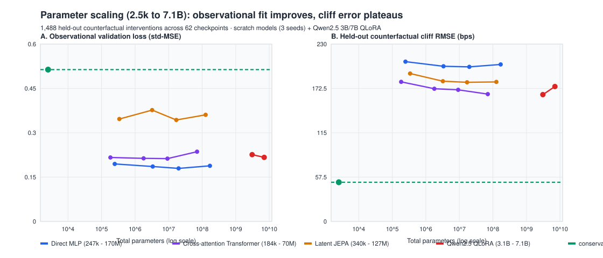
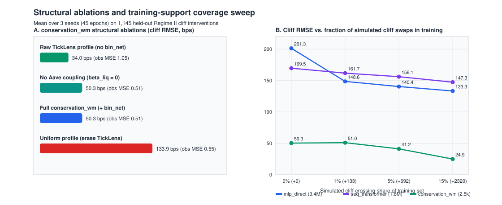

# EVM-Intervene: Counterfactual Intervention Benchmark for World Models on Ethereum Mainnet

[](https://github.com/physicalreasoning/forward/issues/5)
[](results/simulator_verification.json)
[-dc2626)](results/mainnet_intervention_results.json)

This repository implements an empirical intervention test for learned world models in financial state-transition systems, addressing [`physicalreasoning/forward` Issue #5](https://github.com/physicalreasoning/forward/issues/5) (*"Design an intervention test for world models"*).

Using **31,283 real Ethereum Mainnet Uniswap V3 swaps**, **176 historical `TickLens` liquidity-bitmap snapshots**, and **Aave V3 WETH-collateral borrower positions** from the USDC/WETH 0.05% pool (`0x88e6A0c2dDD26FEEb64F039a2c41296FcB3f5640`, spanning June–October 2024 blocks `20,000,000`–`21,000,000`, including the August 5, 2024 market crash), we pair observational next-state prediction against exact EVM counterfactual interventions $\text{do}(a_t = a^{\text{cf}})$ across three physical liquidity regimes:

1. **Regime I (In-Tick Smooth Curve, $0$ ticks crossed):** Continuous $\Delta(\sqrt{P}) = \Delta y / L$ conservation within a single active liquidity bin.
2. **Regime II (Multi-Tick Liquidity Cliffs, $\ge 1$ ticks crossed, no liquidation cascade):** Piece-wise discontinuous transitions where a swap exhausts the active tick and steps across discrete `liquidityNet` boundaries.
3. **Regime III (Endogenous Aave V3 Liquidation Cascades):** Downside price shocks that push leveraged Aave V3 WETH-collateral positions below health factor $1.0$, triggering recursive on-chain collateral liquidations back into the AMM pool.

---

## Core Empirical Findings



1. **Exact EVM Ground-Truth Oracle (Gate G0 = PASS):** Our bit-exact `uint256` / `Q64.96` Python Uniswap V3 simulator ([`src/evm_intervene/simulator.py`](src/evm_intervene/simulator.py)) replays all `31,283` historical Mainnet swaps (including `9,783` multi-tick swaps) with a median price error of **`4.44e-12 bps`** (`p95 = 2.78e-8 bps`, `95.52%` exact post-swap liquidity match; [`results/simulator_verification.json`](results/simulator_verification.json)).
2. **Matched-Loss Counterfactual Divergence (Gate G1 = PASS, Gate G2 = PASS):** On the crash-exposed evaluation arm (`train=8,809`, `val=2,378`, `interventions=936`, 5 seeds), when checkpoints are matched within `5%` of observational validation loss (`0.6131` and `0.6106` vs `0.6169`), unstructured sequence Transformers (`162.00 bps`, `55.04` std-MSE) and Latent JEPA world models (`159.66 bps`, `56.73` std-MSE) suffer **`20x` higher counterfactual cliff std-MSE** than the `2,549`-parameter `ConservationIntegralWorldModel` (`41.86 bps`, `2.71` std-MSE; paired bootstrap gap `+52.28` `[+31.36, +75.91]`, Holm-Bonferroni $p = 0.0012$). Across all 20 trained runs, observational validation loss is **negatively correlated** with counterfactual cliff RMSE ($\rho = -0.535$, $p = 0.0150$).
3. **69,000$\times$ Parameter Scaling & Pretrained 3B/7B QLoRA LLMs Do Not Resolve Boundary Crossing:** Scaling scratch neural architectures from `183,747` to `170,363,907` parameters (`S_150k` $\to$ `XXL_85M`, 3 seeds each) and fine-tuning pretrained **`Qwen/Qwen2.5-3B`** (`3.09B` params) and **`Qwen/Qwen2.5-7B`** (`7.07B` params) backbones via 4-bit QLoRA with a 34-token spatial `TickLens` encoder drives observational validation loss down to `0.1794–0.2260` (beating the copy baseline `0.6834` by $>3\times$) and in-tick error to `1.73–2.06 bps`, yet counterfactual cliff RMSE plateaus at **`164.50–207.22 bps`** (`48.57–53.01` std-MSE) compared to **`50.83 bps`** (`3.48` std-MSE) for the `2,549`-parameter conservation model.
4. **Structural Ablations & Coverage Sweep Isolate the Mechanism:**
   - Removing the learned per-bin residual network (`no_bin_net`, leaving only `4` scalar parameters over the raw `TickLens` profile) doubles observational MSE (`0.5135 -> 1.0472`) while **improving** counterfactual cliff RMSE (`50.34 -> 34.00 bps`, `2.09` std-MSE). Conversely, zeroing the `TickLens` spatial profile (`uniform_profile`) collapses cliff performance to `133.92 bps` (`27.07` std-MSE).
   - Augmenting training data with up to `+15%` (`+2,320`) explicit multi-tick cliff swaps improves all models, yet unstructured MLPs (`133.27 bps`, `31.58` std-MSE) and Transformers (`147.32 bps`, `38.80` std-MSE) still exhibit **`5.3x–5.9x` higher cliff RMSE (`30x–37x` higher std-MSE)** than `conservation_wm` (`24.93 bps`, `1.05` std-MSE) because each block presents a heterogeneous 32-bin step function that must be integrated sequentially rather than memorized.



---

## Summary Benchmark Tables

All tables below are generated directly from committed JSON artifacts via [`scripts/make_report_tables.py`](scripts/make_report_tables.py).

### 1. Primary Benchmark — Crash-Exposed Arm (`results/mainnet_intervention_results.json`)

**`sensitivity_crash_exposed_training`**: `train=8,809`, `val=2,378`, `interventions=936` across `39` held-out checkpoints (`in-tick=225`, `cliff=711`, `cascade=0`). 5 seeds.

| Model | Best obs val std-MSE | Matched obs val std-MSE | In-tick price RMSE (bps) | Cliff price RMSE (bps) | Cliff std-MSE (matched) |
| :--- | ---: | ---: | ---: | ---: | ---: |
| `mlp_direct` | 0.2479 | 0.5361 | 3.50 | 162.07 | 56.40 |
| `seq_transformer` | 0.3153 | 0.6131 | 1.95 | 162.00 | 55.04 |
| `latent_jepa` | 0.4382 | 0.6106 | 6.82 | 159.66 | 56.73 |
| `conservation_wm` | 0.6169 | 0.6169 | 0.22 | 41.86 | 2.71 |
| `copy` (obs val only) | 0.8040 | | | | |

| Challenger vs `conservation_wm` | Within 5% obs loss | Cliff std-MSE gap [95% CI] | Holm $p$ |
| :--- | :---: | :---: | ---: |
| `mlp_direct` | no (15.06%) | +53.66 [+31.69, +78.57] | 0.0012 |
| `seq_transformer` | yes (0.61%) | +52.28 [+31.36, +75.91] | 0.0012 |
| `latent_jepa` | yes (1.03%) | +54.07 [+33.07, +77.73] | 0.0012 |

*Gate G1: **PASS**. Gate G2 (Spearman obs loss vs cliff bps, $n=20$): $\rho = -0.535$, $p = 0.0150$, 95% CI $[-0.802, -0.027]$.*

### 2. Primary Benchmark — Chronologically Sealed Arm (`results/mainnet_intervention_results.json`)

**`primary_chronological_sealed`**: `train=4,309` (calm June 2024), `val=1,178`, `interventions=1,296` across `54` held-out August 5, 2024 crash + October 2024 checkpoints (`in-tick=278`, `cliff=978`, `cascade=40`). 5 seeds.

| Model | Best obs val std-MSE | Matched obs val std-MSE | In-tick price RMSE (bps) | Cliff price RMSE (bps) | Cliff std-MSE (matched) |
| :--- | ---: | ---: | ---: | ---: | ---: |
| `mlp_direct` | 6.5914 | 6.5914 | 3.56 | 221.24 | 15,018.82 |
| `seq_transformer` | 7.6062 | 7.6062 | 2.51 | 220.46 | 14,893.93 |
| `latent_jepa` | 6.9216 | 6.9216 | 1.86 | 218.48 | 14,695.66 |
| `conservation_wm` | 3.6949 | 3.6949 | 1.12 | 35.91 | 395.89 |
| `copy` (obs val only) | 9.1744 | | | | |

### 3. Scratch Neural Scaling Sweep (`results/scaling_sweep_results.json`)

`train=13,148`, `val=2,755`, `interventions=1,488` across `62` held-out checkpoints; 3 seeds per configuration.

| Tier | Model | Params | Obs val std-MSE | Cliff price RMSE (bps) | Cascade price RMSE (bps) |
| :--- | :--- | ---: | ---: | ---: | ---: |
| anchor | `conservation_wm` | 2,549 | 0.5136 | 50.83 | 2,563.9 |
| S_150k | `mlp_direct` | 247,491 | 0.1945 | 207.22 | 4,070.2 |
| S_150k | `seq_transformer` | 183,747 | 0.2164 | 180.99 | 3,965.5 |
| S_150k | `latent_jepa` | 340,227 | 0.3466 | 191.79 | 3,995.2 |
| M_1.5M | `mlp_direct` | 3,367,043 | 0.1858 | 201.19 | 4,092.0 |
| M_1.5M | `seq_transformer` | 1,795,843 | 0.2135 | 172.06 | 3,957.8 |
| M_1.5M | `latent_jepa` | 3,233,091 | 0.3768 | 181.84 | 3,971.0 |
| L_8M | `mlp_direct` | 19,851,523 | 0.1794 | 200.44 | 4,081.4 |
| L_8M | `seq_transformer` | 9,234,435 | 0.2125 | 170.68 | 3,940.0 |
| L_8M | `latent_jepa` | 16,948,035 | 0.3432 | 180.44 | 3,968.8 |
| XXL_85M | `mlp_direct` | 170,363,907 | 0.1881 | 203.61 | 4,085.1 |
| XXL_85M | `seq_transformer` | 70,426,627 | 0.2360 | 165.09 | 3,942.8 |
| XXL_85M | `latent_jepa` | 126,628,163 | 0.3607 | 180.96 | 3,981.8 |

*Spearman (obs loss vs cliff bps), all 39 trained runs incl. anchor: $\rho = -0.512$, $p = 0.0009$. Neural runs only ($n=36$): $\rho = -0.380$, $p = 0.0224$.*

### 4. Pretrained QLoRA Foundation Models (`results/research_v2/llm.json`)

| Backbone | Backbone params | Trainable params | Obs val std-MSE | Beats copy (`0.6834`)? | In-tick RMSE (bps) | Cliff RMSE (bps) | Cliff std-MSE | Cascade RMSE (bps) |
| :--- | ---: | ---: | ---: | :---: | ---: | ---: | ---: | ---: |
| `Qwen/Qwen2.5-3B` (4-bit QLoRA) | 3,085,938,688 | 8,020,995 | 0.2260 | yes | 1.73 | 164.50 | 48.57 | 3,892.8 |
| `Qwen/Qwen2.5-7B` (4-bit QLoRA) | 7,070,619,136 | 11,226,115 | 0.2167 | yes | 2.06 | 174.95 | 53.01 | 3,951.2 |

### 5. Conservation World Model Ablations (`results/research_v2/ablation.json`)

| Variant | Obs val std-MSE | In-tick RMSE (bps) | Cliff RMSE (bps) | Cliff std-MSE | Cascade RMSE (bps) |
| :--- | ---: | ---: | ---: | ---: | ---: |
| `none` (full `conservation_wm`, 2,549 params) | 0.5135 | 0.43 | 50.34 | 3.48 | 2,544.8 |
| `no_bin_net` (raw `TickLens` profile, 4 params) | 1.0472 | 0.58 | 34.00 | 2.09 | 2,191.7 |
| `uniform_profile` (flat `log_rel = 0`, 2,549 params) | 0.5531 | 0.45 | 133.92 | 27.07 | 3,780.2 |
| `no_liq_coupling` ($\beta_{\text{liq}} = 0$, 2,549 params) | 0.5133 | 0.41 | 50.27 | 3.47 | 3,212.1 |

### 6. Training Coverage Sweep (`results/research_v2/coverage.json`)

| Augmented cliff fraction | Added swaps | `mlp_direct` cliff (bps) | `seq_transformer` cliff (bps) | `conservation_wm` cliff (bps) |
| ---: | ---: | ---: | ---: | ---: |
| 0% | +0 | 201.30 (65.67 std-MSE) | 169.52 (48.58 std-MSE) | 50.34 (3.48 std-MSE) |
| 1% | +133 | 148.57 (37.95 std-MSE) | 161.70 (44.74 std-MSE) | 50.99 (3.56 std-MSE) |
| 5% | +692 | 140.38 (34.27 std-MSE) | 156.06 (42.42 std-MSE) | 41.17 (2.46 std-MSE) |
| 15% | +2,320 | 133.27 (31.58 std-MSE) | 147.32 (38.80 std-MSE) | 24.93 (1.05 std-MSE) |

---

## Repository Structure & Reproducibility

```text
evm-intervene/
├── docs/DESIGN.md                     # Protocol specification, state/action representation, and gates G0-G2
├── FINDINGS.md                        # Full technical report with methodology, diagnostics, and limitations
├── data/raw/                          # Cached Mainnet swaps & TickLens snapshots (blocks 14,760,000-14,980,000)
├── src/evm_intervene/
│   ├── simulator.py                   # Bit-exact uint256 / Q64.96 Uniswap V3 state-transition engine
│   ├── state.py                       # 32-bin spatial TickLens profile, 12 global/history scalars, 3D targets
│   ├── models.py                      # MLP, Transformer, Latent JEPA, and ConservationIntegralWorldModel
│   ├── baselines.py                   # Copy, Ridge, and Random-Feature baselines
│   ├── metrics.py                     # Matched-checkpoint selection, block bootstrap, and Holm-Bonferroni tests
│   └── constants.py                   # Pool parameters, decimals, and Aave V2 liquidation thresholds
├── scripts/
│   ├── download_data.py               # Fetches historical swaps & TickLens bitmaps via public Archive RPC
│   ├── verify_simulator.py            # Gate G0 verification across 31,283 Mainnet swaps
│   ├── run_positive_control.py        # Synthetic positive/negative control validation
│   ├── run_experiment.py              # Primary 2-arm Mainnet intervention benchmark (5 seeds)
│   ├── run_scaling_sweep.py           # 184k-170M scratch neural scaling sweep
│   ├── run_research_v2.py             # Ablations, training coverage sweep, and QLoRA LLM fine-tuning
│   ├── run_heavy_suite.py             # Extended Colab Pro suite: 0.5B-14B LLM ladder, multi-step rollouts, execution planner
│   ├── plot_scaling.py                # Generates SVG figures directly from results/*.json
│   └── make_report_tables.py          # Prints all Markdown tables directly from results/*.json
├── notebooks/
│   └── evm_intervene_colab_scaleup.ipynb  # Self-contained Colab Pro GPU notebook
├── results/                           # Committed JSON outputs for all experiments
└── tests/                             # pytest suite verifying Q64.96 math, conservation, and shapes
```

### Quickstart

```bash
pip install -e ".[dev]"
pytest -q
python scripts/verify_simulator.py
python scripts/make_report_tables.py
python scripts/plot_scaling.py
```

---

## License

MIT
