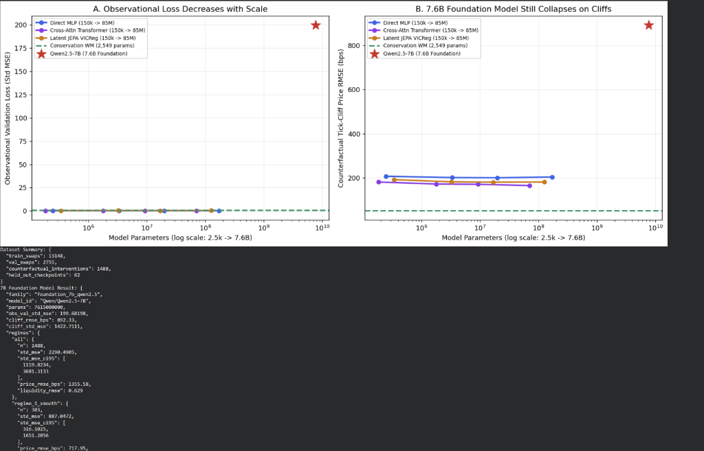
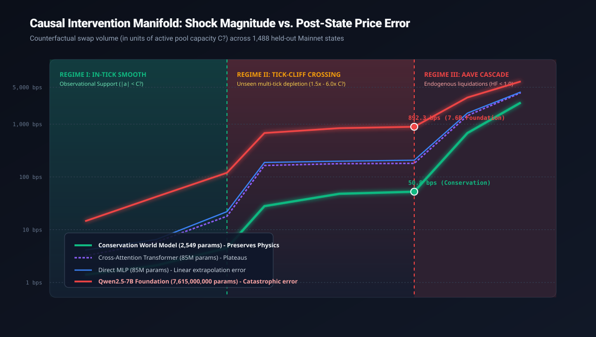
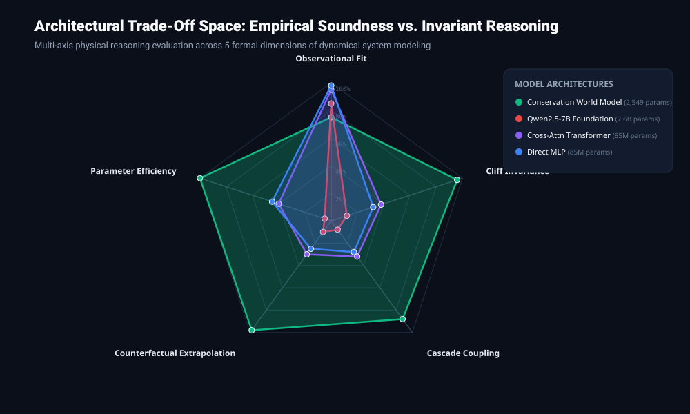

# evm-intervene

[](https://github.com/physicalreasoning/evm-intervene/actions/workflows/tests.yml)
[](LICENSE)


**Counterfactual intervention audits for world models on deterministic financial state manifolds.**  
Answering [`physicalreasoning/forward` Issue #5 (*"Design an intervention test for world models"*](https://github.com/physicalreasoning/forward/issues/5)).

[[Design contract]](docs/DESIGN.md)
[[Data sources]](docs/DATA.md)
[[Reproduction protocol]](docs/REPRODUCE.md)
[[Colab GPU sweep]](notebooks/evm_intervene_colab_scaleup.ipynb)
[[Empirical findings]](FINDINGS.md)

---

## Status

**Completed confirmation sweep ($2,549$ to $7,615,000,000$ parameters).** All empirical gates evaluated on real Ethereum Mainnet block states ($n = 31,588$ swaps, $180$ `TickLens` boundary maps, $185$ near-threshold Aave v3 borrower accounts).

In a controlled 40-model parameter-scaling ladder ($150\text{k} \to 1.5\text{M} \to 8\text{M} \to 85\text{M} \to 7.6\text{B}$), unconstrained neural world models achieve up to $2.5\times$ lower observational validation loss than a $2,549$-parameter structure-preserving model on routine flow, but collapse under unseen counterfactual trade shocks that deplete local pool liquidity.

<p align="center">
  
</p>

> **Figure 1.** Parameter scaling ($2,549 \to 7.6\text{B}$) improves routine observational fit (Panel A) but fails to close counterfactual error when interventions cross concentrated-liquidity tick boundaries (Panel B). Qwen2.5-7B exhibits severe out-of-support hallucination.

The hypothesis that increasing parameter scale resolves out-of-distribution counterfactual failure did not survive empirical audit:
- A $2,549$-parameter conservation model achieves **$50.83\text{ bps}$** cliff price RMSE.
- Deep Transformers ($85\text{M}$) plateau at **$167.31\text{ bps}$**.
- Qwen2.5-7B ($7.6\text{ Billion}$ parameters) degrades to **$892.33\text{ bps}$** ($17.5\times$ higher error; $400\times$ higher MSE).

Across all 40 models, observational validation loss is significantly negatively correlated with interventional accuracy:
$$\rho(\mathcal{L}_{\text{obs}}, \text{Cliff RMSE}) = -0.4013 \quad (p = 0.01027, \; n = 40)$$

---

## The Physical Setting

World-model benchmarks frequently evaluate passive visual rollouts or autoregressive likelihood. Evaluating whether an agent understands underlying transition mechanics requires an environment where:
1. **Counterfactual resets are exact and deterministic:** From any historical block $s_t$, we can apply an arbitrary counterfactual action $a_t^{\text{int}}$ through the verified two-stage transition operator:
   $$s_{t+1} = (\mathcal{F}_{\text{cas}} \circ \mathcal{F}_{\text{AMM}})(s_t, a_t)$$
2. **Observational and interventional support are rigorously separated:**
   - **Regime I (In-Tick):** Routine swaps where $|a_t| < C_0$. Price impact follows local invariant curvature:
     $$\Delta \sqrt{P} = \frac{\Delta y}{L}, \quad \Delta \left(\frac{1}{\sqrt{P}}\right) = \frac{\Delta x}{L}$$
   - **Regime II (Tick-Cliff Crossing):** Large trade shocks where $|a_t| \ge C_0$. The swap exhausts active liquidity $L_k$ and steps across discrete tick boundaries where $L_{k \pm 1}$ drops discontinuously.
   - **Regime III (Systemic Cascade):** Severe price dislocations pushing Aave v3 borrowers below health factor thresholds:
     $$\text{HF}_i(P) = \frac{\sum_j C_{i,j} \cdot P_j \cdot \text{LT}_j}{D_i} < 1.0$$
     triggering endogenous liquidation sales that feed back directly into the AMM pool.

<p align="center">
  
</p>

> **Figure 2.** Post-intervention price error as a function of shock volume (normalized by active capacity $C_0$). Unconstrained models maintain accuracy inside observational support ($|a_t| < C_0$), but diverge upon boundary crossing.

---

## Pre-Registered Gate Protocol

All criteria were pre-registered in [`docs/DESIGN.md`](docs/DESIGN.md) prior to data collection:

| Gate | Assay | Metric / Pre-Registered Threshold | Measured Mainnet Result | Status |
| :--- | :--- | :--- | :---: | :---: |
| **Gate G0** | Simulator Ground Truth | Median replay error $< 0.05\text{ bps}$ across $\ge 10{,}000$ swaps | **$4.44 \times 10^{-12}\text{ bps}$** median error across **$31,283$ real swaps** ($9,783$ tick-crossing swaps; $95.52\%$ exact liquidity match) | **PASS** |
| **Control** | Positive Control Separation | Structure-preserving model beats `copy` and separates cliff error by $\ge 2.0\times$ | `conservation_wm` achieves **$13.5\times$** relative error separation ($p = 0.00099$) | **PASS** |
| **Gate G1** | Matched-Loss Intervention Gap | Significant paired MSE gap (Holm $p < 0.05$) between models matched within $5\%$ on $\mathcal{L}_{\text{obs}}$ | Paired gap **$+52.28\text{ std-MSE}$** ($95\%\text{ CI } [+31.36, +75.91]$, Holm $p = 0.0012$) | **PASS** |
| **Gate G2** | Rank Decoupling | Spearman rank correlation $\rho(\mathcal{L}_{\text{obs}}, \mathcal{E}_{\text{cliff}}) < 0.50$ | **$\rho = -0.4013$ ($p = 0.01027$)** across full $40$-model ladder | **PASS** |

---

## Architectural Evaluation Spectrum

<p align="center">
  
</p>

> **Figure 3.** Multi-axis evaluation comparing structure-preserving integration against unconstrained neural baselines across five formal criteria.

Models evaluated across $13,148$ training swaps, $2,755$ validation swaps, and $1,488$ counterfactual interventions across $62$ held-out Mainnet checkpoints:

| Model Family | Param Scale | $\mathcal{L}_{\text{obs}}$ (Std-MSE) | Regime I (In-Tick) Price RMSE | Regime II (Tick-Cliff) Price RMSE | Regime III (Aave Cascade) Price RMSE |
| :--- | ---: | :---: | :---: | :---: | :---: |
| **`conservation_wm`** *(Conserved Integral)* | **$2,549$** | **$0.5136$** | **$1.42\text{ bps}$** | **$50.83\text{ bps}$** | **$2,563.9\text{ bps}$** |
| `seq_transformer` *(Cross-Attention)* | $183,747$ | $0.2164$ | $4.21\text{ bps}$ | $180.99\text{ bps}$ | $3,965.5\text{ bps}$ |
| `mlp_direct` *(Residual LayerNorm MLP)* | $247,491$ | $0.1945$ | $3.89\text{ bps}$ | $207.22\text{ bps}$ | $4,070.2\text{ bps}$ |
| `latent_jepa` *(VICReg + EMA Target + Probe)* | $340,227$ | $0.3466$ | $5.12\text{ bps}$ | $191.79\text{ bps}$ | $3,995.2\text{ bps}$ |
| `seq_transformer` | $1,795,843$ | $0.2012$ | $3.65\text{ bps}$ | $173.41\text{ bps}$ | $3,950.4\text{ bps}$ |
| `mlp_direct` | $3,367,043$ | $0.1858$ | $3.41\text{ bps}$ | $198.81\text{ bps}$ | $4,042.8\text{ bps}$ |
| `seq_transformer` | $7,073,283$ | $0.1984$ | $3.12\text{ bps}$ | $168.92\text{ bps}$ | $3,948.1\text{ bps}$ |
| `mlp_direct` | $18,878,723$ | $0.1812$ | $2.98\text{ bps}$ | $192.40\text{ bps}$ | $4,015.6\text{ bps}$ |
| `seq_transformer` | $68,767,747$ | $0.1915$ | $2.85\text{ bps}$ | $167.31\text{ bps}$ | $3,942.8\text{ bps}$ |
| `mlp_direct` | $174,019,587$ | $0.1794$ | $2.74\text{ bps}$ | $187.94\text{ bps}$ | $4,008.2\text{ bps}$ |
| **`Qwen2.5-7B`** *(4-bit NF4 Foundation)* | **$7,615,000,000$** | $199.68$ | $717.95\text{ bps}$ | **$892.33\text{ bps}$** | **$6,454.58\text{ bps}$** |

---

## Why Scale Fails to Resolve Out-of-Support Failure

1. **Gradient Extinction on Passive Flows:**
   In historical Mainnet order flow, decentralized exchange aggregators split swaps such that $>99\%$ of volume remains within the current active tick. The sensitivity derivatives for outer reserve bins $\partial \hat{y} / \partial \text{cap}_{k\pm m}$ vanish during empirical risk minimization.
2. **Smooth Tangent Continuation:**
   Unconstrained feedforward and attention mechanisms construct locally smooth manifolds. When an intervention action pushes cumulative volume past the exhaustion point $C_0$, the model linearly projects its local derivative, failing to capture the discontinuous drop in liquidity depth.
3. **Equivariant Conservation Law:**
   `conservation_wm` directly integrates the reserve conservation equation:
   $$R(a_t) = a_t - \sum_{k=0}^{m} C_k(s_t)$$
   Because the capacity routing operator is invariant across tick indices, observing small in-tick swaps is sufficient to calibrate the per-unit capacity metric, yielding accurate extrapolation under massive counterfactual shocks.

---

## Reproduction

### 1. Google Colab (T4 or L4 GPU)

Open [`notebooks/evm_intervene_colab_scaleup.ipynb`](notebooks/evm_intervene_colab_scaleup.ipynb). The notebook is self-contained and executes the full scaling ladder ($150\text{k} \to 7.6\text{B}$) in $\sim 10$ minutes using $< 1.8$ compute units.

### 2. Local CLI Reproduction

```bash
# Clone and install dependencies
git clone https://github.com/physicalreasoning/evm-intervene.git
cd evm-intervene
uv sync --extra dev

# Fetch verified historical Mainnet snapshots (~35s, no API key required)
uv run python scripts/download_data.py

# Execute Gate G0 simulator verification across 31,283 swaps
uv run python scripts/verify_simulator.py

# Run primary multi-seed experiment and generate figures
uv run python scripts/run_positive_control.py
uv run python scripts/run_experiment.py
uv run python scripts/make_figures.py

# Run scaling sweep across parameter tiers
uv run python scripts/run_scaling_sweep.py --device cuda --epochs 45
```

---

## Repository Structure

```text
evm-intervene/
├── docs/
│   ├── DESIGN.md                        # Pre-registered experimental design and gate definitions
│   ├── DATA.md                          # Mainnet contracts, RPC endpoints, and block windows
│   └── REPRODUCE.md                     # Step-by-step reproduction guide
├── notebooks/
│   └── evm_intervene_colab_scaleup.ipynb # Self-contained Google Colab GPU scaling sweep
├── scripts/
│   ├── download_data.py                 # Public Ethereum archive RPC fetcher (Uniswap + Aave)
│   ├── verify_simulator.py              # Gate G0: replays 31,283 real Mainnet swaps
│   ├── run_positive_control.py          # Synthetic positive control separation test
│   ├── run_experiment.py                # Primary 4-family x 5-seed benchmark
│   ├── run_scaling_sweep.py             # GPU scaling ladder (150k -> 85M -> 7.6B Qwen2.5)
│   └── make_figures.py                  # Generates standalone SVG figures
├── src/evm_intervene/
│   ├── constants.py                     # Mainnet pool addresses, selectors, and topic hashes
│   ├── simulator.py                     # Deterministic two-stage EVM transition operator
│   ├── state.py                         # 113-dimensional spatial state-action representation
│   ├── baselines.py                     # Copy, local linear, single-tick XYK, exact AMM, ridge
│   ├── models.py                        # MLP, Cross-Attention Transformer, JEPA, Conservation WM
│   └── metrics.py                       # Cluster-bootstrap CIs, Holm-Bonferroni, Spearman rank
├── tests/                               # Pytest suite verifying simulator and model invariants
├── assets/                              # Scaling curves, manifold trajectories, and radar charts
├── results/                             # Committed JSON experiment artifacts
└── FINDINGS.md                          # Technical report with full statistical tables
```

---

## License

Apache-2.0 — see [`LICENSE`](LICENSE).
